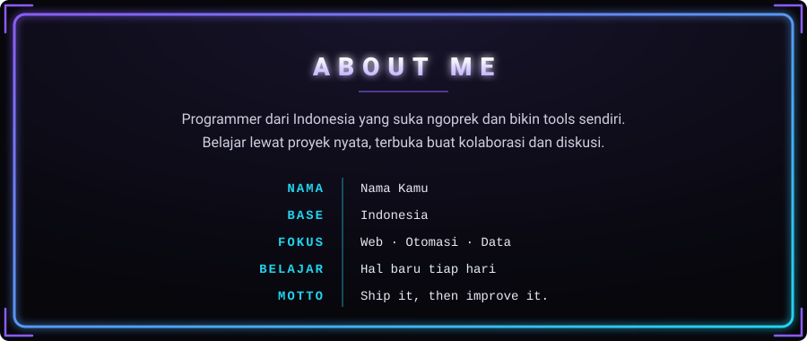
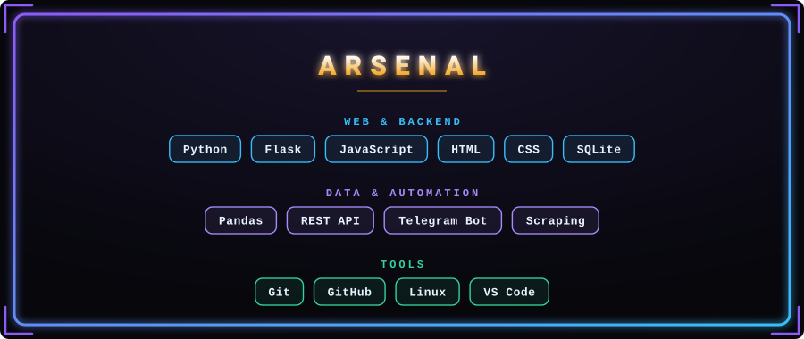

<!-- ============================================================
  CARA PASANG
  1. Buat repo PUBLIC dengan nama sama persis dengan username GitHub kamu
  2. Upload README.md ini + folder assets/ (3 file .svg) ke repo itu
  3. Cari-ganti semua "USERNAME" dan link contoh di bawah dengan punyamu
  4. Teks di dalam gambar (nama, bio, skill) diedit di file .svg
     (buka pakai editor teks, cari teks yang mau diganti)
============================================================ -->

 

 

 

### 📡 HUBUNGI AKU

<!-- Hapus baris yang tidak dipakai. Ganti USERNAME / link dengan punyamu. -->

 

  

